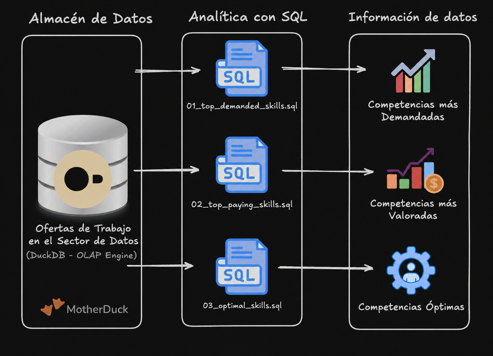
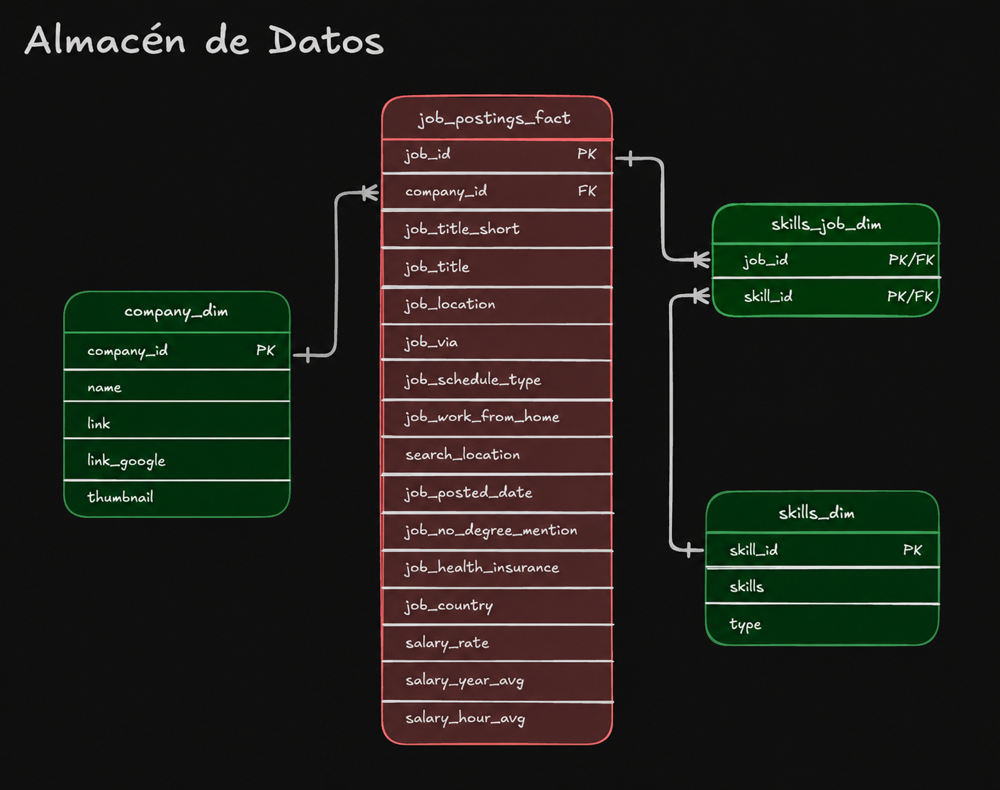

# Data Job Market in Spain  - Exploratory Data Analysis with SQL
[Haz clic aquí para leer en Español](#trabajos-en-el-sector-de-datos-en-españa---análisis-exploratorio-con-sql)


A SQL project analyzing the data engineer job market as well as the overall data job market in Spain using real world job posting data between January 2023 and June 2025.

This study demonstrates my ability to: 
- write production-quality analytical SQL
- design efficient queries
- turn career-related questions into data-driven insights


## Executive Summary

- **Project Scope:** Built **3 analytical queries** that answer key questions about the data job market in Spain
- **Data Modeling:** Utilized **multi-table joins** across fact and dimension tables to extract key insights
- **Analytics:** Applied **aggregations**, **filtering**, and **sorting** to find top skills by demand, salary and overall value
- **Outcomes:** Delivered **actionable insights** on SQL/Python dominance, cloud trends, specialized skills, and improvments for future studies

Feel free to review these SQL query files: 
1. [`01_top_demanded_skills.sql`](01_top_demanded_skills.sql) – skill demand analysis with multi-table joins
2. [`02_top_paying_skills.sql`](02_top_paying_skills.sql) – salary analysis with aggregations
3. [`03_optimal_skills.sql`](03_optimal_skills.sql) – combined demand/salary optimization query


## Problem & Context

Questions one may have about the job market: 

- **Most in-demand:** *Which skills appear most frequently in job postings for data jobs*
- **Highest Paid:** *Which skills command the highest salaries*
- **Best trade-off:** *what is the most optimal skill set balancing demand and compensation*

This project analyzes a **data warehouse** built using a star schema design. The warehouse structure consists of: 


- **Fact Table:** `job_postings_fact` — central table containing job posting details (job titles, locations, salaries, dates, etc.)
- **Dimension Tables:**
    - `company_dim` — company information linked to jobs postings
    - `skills_dim`  — skills catalog with skill names and types
- **Bridge Table:** `skills_job_dim` — resolves the many-to-many relationship between job postings and skills

Insights about skill demand, salary patterns, and optimal skill combinations for data roles were extracted by querying across these interconnected tables. 

## Tech Stack
- **Query Engine:** - DuckDB for fast OLAP-style analytical queries (and it was free XD)
- **Language:** - SQL (ANSI-style with analytical functions)
- **Data Model:** - Star schema (fact + bridge tables + dimension)
- **Development:** - VS Code for SQL editing + Terminal for DuckDB CLI
- **Version Control:** - Version Control: Git/GitHub for versioned SQL scripts


## Repository Structure
```
    1_EDA/
    ├── 01_top_demanded_skills.sql      # demand query & analsysis
    ├── 02_top_paying_skills.sql        # salary query & analsysis
    ├── 03_optimal_skills.sql           # optimization query & analsysis
    ├── README.md
    ├── data_jobs.duckdb
    └── images
```

# Analysis Overview
## Query Structure

1. [Top Demanded Skills](01_top_demanded_skills.sql) – Identifies the 10 most mentioned skills for data engineer positions in Spain
2. [Top Paying Skills](02_top_paying_skills.sql) – Analyzes highest-paying skills with salary and demand metrics
3. [Optimal Skills](03_optimal_skills.sql) – Calculates an optimal score using natural log of mention count combined with median salary to identify the most valuable skills to learn

## Key Inights
- 🐍 **Core Languages:** Python & SQL consistently appeared as the most demanded skills given different query filters. This strongly supports the notion as them being foundational skills for data roles across the board. 
- ☁️ **Cloud Platforms:** AWS and Azure are critical to  modern data roles.
- 🛠️ **Big data tools:** Apache Spark & Data Bricks show strong demand with competitive compensation


# SQL Skills Demonstrated

## Query Design & Optimization
- **Complex Joins:** Multi-table `INNER JOIN` operations across `job_postings_fact`, `skills_job_dim`, and `skills_dim`
- **Aggregations:** `COUNT()`, `MEDIAN()`, `ROUND()` for statistical analysis
- **Filtering:** Boolean logic with `WHERE` clauses and multiple conditions (`job_title_short`, `job_country`, `salary_year_avg IS NOT NULL`)
- **Sorting & Limiting:** `ORDER BY` with `DESC` for top-N analysis

## Data Analysis Techniques
- **Grouping:** `GROUP BY` for categorical analysis by skill
- **Mathematical Functions:** `LN()` for natural log transformation to normalize demand counts
- **Calculated Metrics:** Derived optimal score by multipying log-transformed demand counts to median salary and normalizing based on the highest score rounded up
- **Having Clause:** Filtering aggregated results (skills with >= 100 or 10 depending on filter)
- **Null Handling:** Proper filtering of incomplete salary records (`salary_year_avg IS NOT NULL`)
---
---
---

# Trabajos en el Sector de Datos en España - Análisis Exploratorio con SQL
[Click here for English](#data-job-market-in-spain----exploratory-data-analysis-with-sql)



Un proyecto de SQL que analiza el mercado laboral para ingenieros de datos y tambien el mercado laboral general del sector de datos en España, utilizando datos reales de ofertas de empleo publicadas en línea entre enero de 2023 y junio de 2025

Este estudio demuestra mi capacidad de: 
- formar consultas SQL analíticas con calidad de producción
- Diseñar consultas eficientes
- transformar preguntas relacionadas con la formación profesional en conclusiones basadas en datos


## Resumen Ejecutivo 

- **Alcance del Proyecto:** Desarrollé **3 consultas analíticas** que responden reguntas clave sobre el mercado laboral del sector de datos en España
- **Modelado de Datos:** Utilicé **uniones entre tablas** denominadas como *fact tables* y *dimension tables* para extraer información clave.
- **Datos Analíticos:** Apliqué **funciones de agregación**, **filtros**, y **ordenamiento** para identificar las competencias más demandadas, mejor remuneradas y de mayor valor general. 
- **Resultados:** Rendí **conclusiones prácticas** sobre el predominio de SQL/Python, las tendencias de plataformas cloud, las competencias especializadas y las mejoras para futuros estudios. 

Podéis revisar estos archivos de consultas SQL mendiante los enlaces: 
1. [`01_top_demanded_skills.sql`](01_top_demanded_skills.sql) – Análisis de la demanda de competencias mediante uniones entre múltiples tablas
2. [`02_top_paying_skills.sql`](02_top_paying_skills.sql) – Análisis de salario mediante funciones de agregación
3. [`03_optimal_skills.sql`](03_optimal_skills.sql) – Optimización que combina la demanda y los salarios


## Problema y Contexto

¿Qué preguntas pudieramos tener acerca del mercado laboral?

- **Más demandadas:** *¿Qué competencias aparecen con mayor frecuencia en el sector de datos?*
- **Mejor remuneradas:** *¿Qué competencias ofrecen los salarios más altos?*
- **Mejor equilibrio entre demanda y remuneración:** *¿Cuál es el conjunto de competencias más óptimo para equilibrar la demanda laboral y la remuneración?*

Este proyecto analiza un almacén de datos diseñado utilizando un *star schema* (esquema en estrella). La estructura del almacén de datos consta de lo siguiente:



- **Fact Table:** `job_postings_fact` — tabla central que contiene los detalles de las ofertas de empleo (títulos de puestos, ubicaciones, salarios, fechas, etc.)
- **Dimension Tables:**
    - `company_dim` — información de las empresas vinculada a las ofertas de empleo
    - `skills_dim`  — catálogo de competencias con sus nombres y denominaciones
- **Bridge Table:** `skills_job_dim` — resuelve la relación de *many-to-many* entre las ofertas de empleo y las competencias

Se obtuvieron conclusiones sobre la demanda de competencias, los patrones salariales y las combinaciones óptimas de competencias para puestos en el sector de datos mediante consultas a estas tablas interconectadas.

## Stack Tecnológico
- **Motor de consultas:** DuckDB para ejecutar consultas analíticas rápidas de tipo OLAP (¡y encima era gratis! XD)
- **Lenguaje:** SQL (estilo ANSI, con funciones analíticas)
- **Modelo de Datos:** Esquema en estrella (*star schema*), con tabla de hechos (*fact table*), una tabla puente (*bridge table*) y tablas de dimensiones (*dimension table*)
- **Entorno de Desarrollo:** VS Code para editar SQL y la terminal para trabajar con la CLI de DuckDB
- **Control de Versiones:** Git y GitHub para gestionar el historial de cambios de los scripts SQL